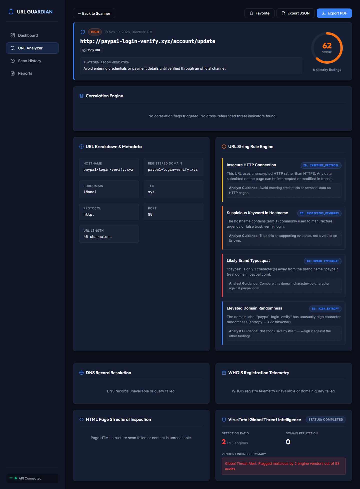
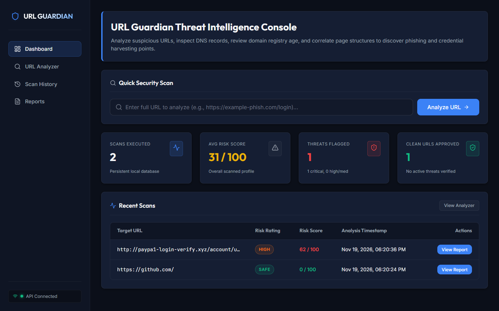
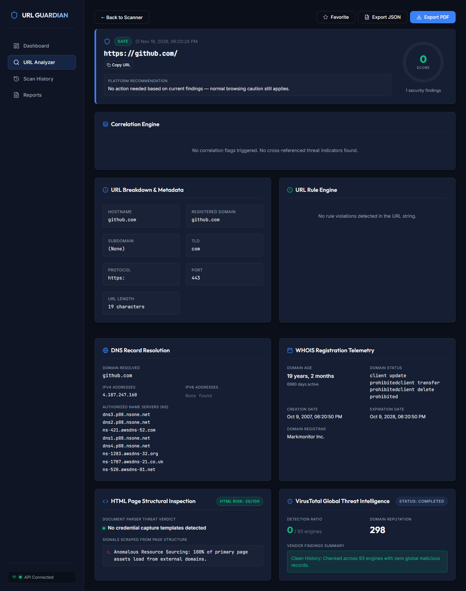

# URL Guardian — URL Analysis Engine v2

A phishing and malicious-URL detection system built as a Final Year Project. It analyzes a URL through several independent intelligence layers, correlates the signals across them, and produces an explainable risk score.

## Features

- **Lexical URL analysis**: a custom rule engine that checks for brand impersonation and typosquatting (Levenshtein distance), homograph and punycode attacks, suspicious keywords, high-entropy strings, IP-based hosts, URL shorteners, risky file extensions, non-standard ports, subdomain abuse and redirect patterns.
- **DNS lookup**: resolves IPv4/IPv6 addresses and name servers.
- **WHOIS lookup**: domain age, registrar and expiry, so newly registered domains can be flagged.
- **HTML content analysis**: fetches the page through ScrapingBee and inspects it for phishing indicators (forms, credential fields, obfuscation and so on).
- **VirusTotal reputation**: aggregated verdicts from VirusTotal's scanning engines.
- **Correlation engine**: combines signals from different sources, for example *new domain + brand keyword + login form*.
- **Explainable risk scoring**: a 0–100 score, a risk level, the contribution of each signal and a plain-language justification.
- **Dashboard UI**: an analyzer, scan history, reports and export.

## Screenshots

**Phishing URL detected.** A leet-speak PayPal typosquat is flagged HIGH:



| Dashboard | Safe URL result |
| --- | --- |
|  |  |

## Architecture

```
client/  (React 19 + Vite)
   │  POST /api/analyze { url }
   ▼
server/  (Node.js + Express 5)
   ├─ validate middleware (http/https only)
   └─ analysis.service ── runs in parallel ──┬─ dns.service
                                             ├─ whois.service       (whoisjson.com)
                                             ├─ htmlFetcher/Analyzer (ScrapingBee + cheerio)
                                             ├─ virusTotal.service  (VirusTotal v3)
                                             └─ urlLexical.service  (url-lexical-engine)
                         ▼
             correlation.service → risk.service → explanation.service
```

### Risk levels

| Score  | Level    |
| ------ | -------- |
| 0      | SAFE     |
| 1–20   | LOW      |
| 21–40  | MEDIUM   |
| 41–70  | HIGH     |
| 71–100 | CRITICAL |

## Getting started

### Prerequisites

- Node.js **20.19+**
- API keys (free tiers work):
  - [VirusTotal](https://www.virustotal.com/gui/my-apikey)
  - [WhoisJSON](https://whoisjson.com)
  - [ScrapingBee](https://www.scrapingbee.com)

### 1. Backend

```bash
cd server
npm install
cp .env.example .env      # then add your API keys to .env
npm run dev               # http://localhost:5000
```

### 2. Frontend

```bash
cd client
npm install
npm run dev               # http://localhost:5173
```

The frontend reads the backend URL from `VITE_API_URL` (see `client/.env.example`). In development it defaults to `http://localhost:5000`. In a production build it defaults to the same origin as the frontend.

### Configuration (`server/.env`)

| Variable                    | Default                 | Description                                                        |
| --------------------------- | ----------------------- | ------------------------------------------------------------------ |
| `PORT`                      | `5000`                  | API port                                                           |
| `VIRUSTOTAL_API_KEY`        | —                       | VirusTotal v3 API key                                              |
| `WHOIS_API_KEY`             | —                       | WhoisJSON API key                                                  |
| `SCRAPINGBEE_API_KEY`       | —                       | ScrapingBee API key                                                |
| `CORS_ORIGIN`               | `http://localhost:5173` | Comma-separated list of allowed frontend origins                   |
| `RATE_LIMIT_WINDOW_MINUTES` | `15`                    | Rate-limit window for `POST /api/analyze`                          |
| `RATE_LIMIT_MAX`            | `20`                    | Maximum scans per IP in each window                                |
| `LOG_LEVEL`                 | `info`                  | `error`, `warn`, `info` or `debug` (`debug` logs scanned URLs)     |

## Security

- **Input validation:** only `http:` and `https:` URLs up to 2048 characters are accepted, parsed with the WHATWG `URL` API.
- **Rate limiting:** scans are limited per IP to protect third-party API quotas.
- **CORS:** only the origins listed in `CORS_ORIGIN` are allowed.
- **Security headers:** set with [helmet](https://helmetjs.github.io/).
- **Request size:** JSON bodies are limited to 10 KB.
- **Errors:** responses are always JSON and never expose stack traces.
- **Secrets:** API keys live only in `server/.env`, which is gitignored.

## API

### `GET /api/analyze`

Health check.

```json
{ "status": "ok", "message": "URL Guardian API is running." }
```

### `POST /api/analyze`

```json
{ "url": "https://example.com" }
```

Errors return `{ "success": false, "message": "..." }` with status `400` (invalid input), `413` (body too large), `429` (rate limited) or `500`.

Response (abridged):

```json
{
  "url": "https://example.com/",
  "findings": { "dns": {}, "whois": {}, "html": {}, "virustotal": {}, "lexical": {} },
  "correlations": [],
  "score": 0,
  "risk": "SAFE",
  "explanation": {}
}
```

## Scripts

| Location | Command            | Description                                   |
| -------- | ------------------ | --------------------------------------------- |
| server   | `npm run dev`      | Start the API with auto-reload                |
| server   | `npm start`        | Start the API                                 |
| server   | `npm test`         | Run unit tests (`node:test`)                  |
| server   | `npm run validate` | Run the engine accuracy suite on mock scenarios (reports classification and exact-level accuracy) |
| client   | `npm run dev`      | Start the Vite dev server                     |
| client   | `npm run build`    | Production build to `client/dist`             |
| client   | `npm run lint`     | Lint with oxlint                              |

## Project structure

```
├── docs/screenshots/        # README images
├── client/
│   └── src/
│       ├── api/            # backend API client
│       ├── components/     # analysis panels, gauges, navigation
│       ├── hooks/          # scan history
│       ├── pages/          # Analyzer, Dashboard, History, Reports
│       └── utils/          # formatters, export helpers
└── server/
    ├── src/
    │   ├── controllers/
    │   ├── middleware/     # logger, URL validation, rate limiting, error handling
    │   ├── routes/
    │   ├── scripts/        # engine validation suite
    │   ├── services/       # intelligence layers, correlation, risk, explanation
    │   │   └── backend-integration/url-lexical-engine/
    │   └── utils/          # leveled logger
    └── test/
```

## Acknowledgements

- Public suffix data comes from the [Mozilla Public Suffix List](https://publicsuffix.org/) (MPL-2.0).

## Disclaimer

This tool is for educational and research purposes. Its risk scores are heuristic and can produce false positives or negatives. Don't rely on it as your only security control.

## License

[MIT](LICENSE)
